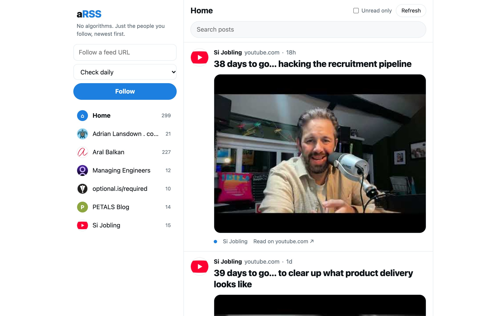

# aRSS

**aRSS** (a Really Simple Syndication app) is an open source, self-hosted RSS reader with a timeline UI akin to social media.

It's an attempt to make it easier to decentralise your social circle's content with no surveillance capitalism or anti-social algorithms trying to influence your experience.

It's easy to remember with a bit of cheeky word-play (pronounced "_arse app_").

It's an open source project, built by a community of people who will be using it.

## The story so far

aRSS was conceived back in 2018, as Twitter was taking another turn for the worse. It was inspired by [Aral Balkan](https://ar.al/)'s [blog to revive Really Simple Syndication (RSS)](https://ar.al/2018/06/29/reclaiming-rss/) and followed up on some similar thoughts by [Si](https://sijobling.com/) from around the same time.

Like many side projects, it lost traction and motivation. Thanks to agentic (vibe) coding, it has received a new lease of life.

## Why RSS?

- **Decentralised by design.** Every site publishes its own feed. There's no central service to change the rules, rank your posts or switch off.
- **Owned by the creator.** The feed lives on the author's own site, so you follow the person rather than their account on someone else's platform.
- **Really simple.** It's a small text file listing what's new (hence the name), which makes it easy to publish, read and build on.
- **Extremely versatile.** Because it's so simple, it's already everywhere: blogs, podcasts, YouTube channels, newsletters, changelogs.

This gives us a chance to tap into data structures that already exist, where people can publish once and syndicate everywhere ([POSSE](https://indieweb.org/POSSE)).

## What you get

- A single chronological timeline of everything you subscribe to: blogs, podcasts, YouTube channels, newsletters, anything with an RSS or Atom feed
- Per-feed views, search and unread tracking
- A fetch schedule per feed (hourly, daily, weekly or custom minutes)
- An [MCP](https://modelcontextprotocol.io/) service, so your agent of choice can search your feeds and find content you read and have since forgotten
- One small Node server and a SQLite file, with no accounts and no native dependencies. Run it locally, or deploy it somewhere you trust to keep it safe

## Getting started

You need [Node.js](https://nodejs.org/) 22.13 or newer.

    git clone https://github.com/aRSSapp/arss-web.git
    cd arss-web
    npm install
    npm start

Then open <http://127.0.0.1:3333> and paste in a feed URL to subscribe.

### Example feeds

To start with something to read, add the example feeds in [seed/feeds.json](seed/feeds.json):

    npm run seed

It's safe to re-run, as feeds you already have are skipped. The running server fetches new feeds on its next tick (within a minute), or press "Refresh" to fetch straight away.

### Configuration

| Variable | Default | What it does |
| --- | --- | --- |
| `PORT` | `3333` | Port the web UI and API listen on |
| `HOST` | `127.0.0.1` | Set to `0.0.0.0` to reach it from other devices. There is no auth on the web UI, so only do this on a trusted network |
| `ARSS_DB` | `data/arss.db` | Path to the SQLite database |
| `ARSS_TOKEN` | unset | Bearer token required by the HTTP MCP endpoint at `/mcp` |

### Tests

    npm test

## Use it with your agent (MCP)

aRSS exposes `list_feeds`, `get_items`, `get_item` and `mark_read` as MCP tools, over stdio for the same machine or over HTTP for remote clients. Any MCP-capable agent can connect. For example, with Claude Code on the same machine:

    claude mcp add arss -- node /path/to/arss-web/src/mcp.js

See [APP.md](APP.md) for the HTTP endpoint, tokens, keeping the server running with launchd and exposing it safely.

## Project layout

- `src/server.js` - web UI, JSON API and per-feed scheduler
- `src/fetcher.js`, `src/db.js` - feed fetching and SQLite storage
- `src/mcp.js`, `src/mcp-http.js`, `src/mcp-tools.js` - MCP server (stdio and HTTP)
- `public/` - the reader UI
- `seed/` - example feeds
- `site/` - the project landing page

## Landing page

The landing page at [arss.app](https://arss.app) lives in `site/`. It is plain static HTML, deployed to a Cloudflare Worker as static assets (see [wrangler.jsonc](wrangler.jsonc)). The reader app itself is not part of that deployment.

    npm run site          # preview locally with wrangler dev
    npm run deploy:site   # deploy to Cloudflare (asks you to log in the first time)

## Ideas

* Subscribe to your contacts' websites and blogs
* Use existing social circles to find content sources (e.g. who you already follow elsewhere)
* Comment directly on a post **if possible**
* Filter content by
	* Tags
	* Categories
	* Personal
* Post directly from aRSS with secure authentication
	* Encourage micro posts with oEmbed
	* Link to external content (e.g. YouTube, Soundcloud, Github…)
	* Attach media directly (photos, audio, video)
	* Configure default categories, taxonomy
	* Location awareness?
* Share / repost directly to your own site
* Installable as a Progressive Web App, friendly to touch and desktop alike

## Questions

* Is it social if you can't interact?
* You can reshare but how do you respond?
* How do you decentralise comments?
* Encourage enabling blog comments, but what tools are there to limit spam, hate and trolls?

## How to get involved

We're looking for advocates for RSS and open standards, people to help shape requirements, designers (UX & UI) and engineers.

- Open an issue or pull request on [GitHub](https://github.com/aRSSapp/arss-web)
- Try it out and tell us what's missing

----

_Reclaim your content._
